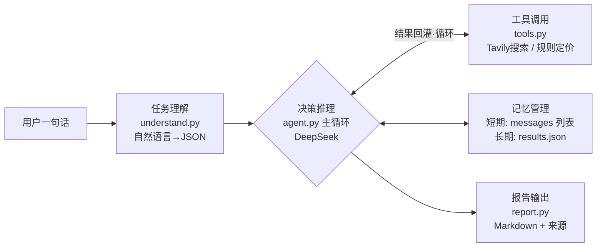

# 选品分析 Agent · 手写最小内核

> 从零手写的 AI Agent：**不依赖任何 Agent 框架**，约 400 行 Python 实现「任务理解 → 决策推理 → 工具调用 → 记忆管理 → 报告输出」完整链路。
>
> 输入一句中文品类描述，自动产出带来源标注的跨境电商选品报告（市场热度 / 竞争格局 / 定价建议 / 切入策略）。



## 为什么手写而不用框架

LangChain 等框架是黑盒，出了问题不知道发生在哪一层。本项目每个模块 50~100 行、全部亲手实现——**每个行为都可解释、可调试、可在面试白板上推导**。这也是本项目的主要产出：不是这个 Agent 本身，而是对 Agent 运行机制的完整掌握。

## 核心模块

| 文件 | 职责 | 行数 |
|---|---|---|
| `understand.py` | 任务理解：自然语言 → 结构化 JSON（JSON 模式 + temperature=0 + 失败重试） | ~60 |
| `tools.py` | 工具注册表 + 统一执行器 + Tavily 真实搜索 + 规则定价工具 | ~100 |
| `agent.py` | 决策推理主循环：function calling 意图 → 执行 → 结果回灌 → 再推理 | ~100 |
| `memory.py` | 长期记忆：结果落盘 JSON + 相似品类检索注入 | ~55 |
| `report.py` | 报告生成：元信息头 + 正文 + 免责声明 → Markdown 文件 | ~70 |
| `chat.py` | 对话内核（教学中间产物）：多轮对话 + 历史裁剪 | ~45 |

## 快速开始

```bash
pip install openai python-dotenv httpx

# 配置 .env
# DEEPSEEK_API_KEY=sk-xxx   (https://platform.deepseek.com)
# TAVILY_API_KEY=tvly-xxx   (https://app.tavily.com，免费 1000 次/月)

python report.py "帮我分析便携榨汁机"
# → data/reports/report_portable_blender_<时间戳>.md
```

## 示例输出

见 [`data/reports/`](data/reports/) 下的真实报告。特征：

- 每个关键数字**标注来源**（Wirecutter / CNET / Market.us 等）
- 多机构口径冲突时**交叉验证并列出**，不做单一采信
- 工具未覆盖的维度**显式标注"数据不足"**，禁止编造
- 定价建议由**规则工具**计算（成本 × 经验倍率），成本数值可溯源到搜索结果

## 技术要点（均可白板推导）

1. **LLM 是无状态的**——所谓记忆就是每次全量重发历史消息列表；短期记忆 = `messages` 列表 + 裁剪（system 人设永不裁剪）
2. **Function calling 的真相**——模型只输出"调用意图"（函数名 + 参数 JSON），执行者是你的代码；三要素：工具说明书（spec）、调用意图（tool_calls）、结果回灌（role=tool，tool_call_id 必须一一对应）
3. **确定性计算不交给 LLM**——定价 = 成本 × 经验倍率，是规则工具；模型负责从搜索结果里提取成本并注明出处
4. **错误回灌自愈**——工具报错不抛异常，把错误文本回灌给模型让它自己调整参数
5. **保险丝机制**——`max_steps=8` 防止无限工具调用（完整选品链路实测 6 轮推理）
6. **双层记忆**——短期（对话历史，内存）/ 长期（JSON 落盘，磁盘）；历史以 300 字摘要注入，复用结论只补搜缺失
7. **诚实性约束**——system 提示词强制"数据不足就说数据不足"，实测模型面对空数据会拒绝编造并给出可行的细分检索建议

## 成本

单份完整报告 ≈ 0.02~0.05 元（DeepSeek API）+ 5~10 次 Tavily 免费额度调用。开发全程总成本 < 1 元。

---

*本项目为个人学习作品。求职场景下配套文档（STAR 描述 / 面试话术）另行归档。*
